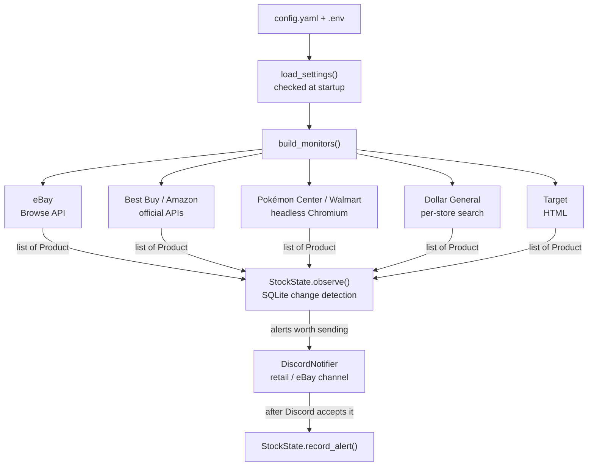

# Pokegrab

Pokegrab is an async Python service that watches retailers and eBay for Pokémon TCG products and posts Discord alerts when something worth buying appears: a sealed product coming back in stock, or an eBay listing at or close to MSRP.

It is **alert-only**. It never adds items to a cart or checks out, and it does not get around anti-bot protection. There are no proxies, captcha solvers or browser fingerprint tricks. When a store blocks it, that scan is skipped and logged.

## Contents

- [Features](#features)
- [Supported retailers](#supported-retailers)
- [Example Discord alerts](#example-discord-alerts)
- [Architecture](#architecture)
- [Setup](#setup)
- [Configuration](#configuration)
- [Development](#development)
- [Limitations](#limitations)

## Features

- **Restock detection, not stock spam.** It alerts when a product changes from out of stock to in stock. The first scan of each store records what is already on the shelf without posting.
- **Per-product cooldown.** After an alert, the same product stays quiet for a configurable period (6 hours by default), even if it goes in and out of stock or is relisted.
- **eBay MSRP pricing.** It matches listing titles to an MSRP table and posts only listings whose price plus shipping falls inside a band around MSRP. Each alert shows how far above or below MSRP the listing is.
- **Accessory and scam filtering.** A price floor and an exclude list drop listings like "Elite Trainer Box playmat" or "empty box" that use a full product's name for a single accessory.
- **Japanese, Korean and Chinese prints.** A language word in the title switches to that language's MSRP table, converted from yen or won, with its own allowed markup.
- **Store-level stock at Dollar General.** It reads shelf counts for specific stores, configured by store number.
- **Separate Discord channels.** eBay alerts can go to their own channel; retail alerts go to the main one.
- **Per-store scan intervals,** so each store stays within its API quota and is polled at a sensible rate.
- **Reliable delivery.** An alert is recorded only after Discord accepts it. Rate limits (HTTP 429) are retried using Discord's `retry_after`.
- **Docker deployment** with automatic restart and a persistent state volume.

## Supported retailers

| Store | Config key | How it reads stock | Requirements | Status |
|---|---|---|---|---|
| eBay | `ebay` | Official Browse API (OAuth client credentials) | eBay production keyset | Working |
| Dollar General | `dollargeneral` | The website's own search request, run in headless Chromium, pointed at each configured store | Playwright and Chromium | Working |
| Pokémon Center | `pokemoncenter` | Search page rendered in headless Chromium | Playwright and Chromium | Working, but often serves challenge pages |
| Best Buy | `bestbuy` | Official Products API | Best Buy developer API key | Supported (needs key) |
| Amazon | `amazon` | Amazon Creators API (OAuth) | Amazon Associates account with API access | Supported (needs approval) |
| Target | `target` | Plain HTML search page | None | Finds 0 products: results are built with JavaScript |
| Walmart | `walmart` | Search page rendered in headless Chromium | Playwright and Chromium | Blocked by Walmart's bot protection |

A store without its keys is skipped at startup with a warning; the other stores keep running.

## Example Discord alerts

Alerts are Discord embeds. The title links to the product and the product image is shown as a thumbnail.

**Retail restock**

```text
┃ Pokémon TCG: 30th Celebration Elite Trainer Box
┃ Best Buy · $49.99
```

**eBay listing priced against MSRP**

```text
┃ Pokemon 30th Celebration Booster Bundle Sealed
┃ eBay · $24.99 + $4.00 shipping = $28.99
┃ MSRP $26.94 · +$2.05 (+7.6%) over MSRP
```

```text
┃ Pokemon TCG Knock Out Collection Eevee 30th Celebration
┃ eBay · $9.49 with free shipping
┃ MSRP $9.99 · $0.50 (5.0%) under MSRP
```

**Asian-language print**

```text
┃ Pokemon Card Game Abyss Eye Booster Box Japanese Sealed
┃ eBay · $45.00 + $15.00 shipping = $60.00
┃ Japanese MSRP $37.97 · +$22.03 (+58.0%) over MSRP
```

**Dollar General shelf count**

```text
┃ Pokémon Trading Card Game, 15 Card Pack, 1 ct
┃ Dollar General · 4115 N El Dorado St, Stockton · $8.00
┃ 5 on the shelf (store's count)
```

**Status messages**, posted to each channel when the bot starts and stops:

```text
👋 Pokegrab is online! Monitoring: pokemoncenter, target, dollargeneral!
🔴 Pokegrab is going offline.
```

## Architecture



Each store runs as its own `asyncio` loop that scans, processes the results and sleeps for that store's interval. A slow or blocked store never delays the others.

### Main pieces

| Module | Responsibility |
|---|---|
| `pokegrab/models.py` | `Product`, the frozen dataclass every store converts its data into |
| `pokegrab/monitors/` | One adapter per store. `base.Monitor` sets the interface and behavior flags |
| `pokegrab/state.py` | SQLite tables for change detection, baselines and alert cooldowns |
| `pokegrab/match.py` | Whole-word keyword matching and MSRP lookup |
| `pokegrab/discord.py` | Discord embed formatting and rate-limit retries |
| `pokegrab/config.py` | YAML and `.env` loading into a frozen `Settings` object |
| `pokegrab/main.py` | Builds the monitors, routes each to its channel and runs the loops |

### Key design decisions

- **One product model.** Each store has its own data format, so every monitor converts its data to `Product`. Filtering, state and Discord never know which store an item came from, so adding a store means writing one parser.
- **Alert on change, not on state.** The `observations` table stores each product's last-known stock status. An alert fires only when that status changes to in stock. The `baselines` table makes each store's first scan silent, so restarting the bot doesn't repost everything.
- **Cooldown with title fingerprints.** The `alerts` table records when each product was last posted. eBay sellers often relist an item, which gives it a new id, so eBay alerts are also keyed on a title fingerprint: lowercase words, with filler like "new", "sealed" and "fast shipping" removed, sorted.
- **At-least-once delivery.** An alert is written to the database only after Discord accepts the post. A failed post is retried on the next scan instead of being lost.
- **Longest-match MSRP lookup.** When several MSRP entries match a title, the longest phrase wins. "Pokémon Center Elite Trainer Box" beats "Elite Trainer Box", and "Knock Out Collection" beats the generic "Collection Box". Matching treats hyphens like spaces and "é" like "e".
- **eBay price band.** A listing must satisfy `floor% × MSRP ≤ price + cheapest shipping ≤ MSRP × (1 + markup%)`. The ceiling rejects scalper prices. The floor (60% by default) rejects accessories sold under a full product's name.
- **Fail closed on blocks.** Challenge pages raise `BlockedPage`, so the scan is skipped without updating any state. A block can never make an in-stock product look sold out.

## Setup

### Requirements

- Python 3.11 or later, or Docker
- A Discord server where you can create webhooks
- API keys for the stores you want to use (see [Supported retailers](#supported-retailers))

### 1. Create Discord webhooks

In each Discord channel you want alerts in, open **Edit Channel**, go to **Integrations**, then **Webhooks**, create a new webhook and copy its URL. You can use one channel for everything, or separate channels for retail and eBay.

### 2. Add secrets to `.env`

Copy `.env.example` to `.env` and fill in the values you have. Blank values turn that store off.

```dotenv
DISCORD_WEBHOOK_URL=https://discord.com/api/webhooks/...
# Optional: post eBay alerts to a different channel
DISCORD_EBAY_WEBHOOK_URL=https://discord.com/api/webhooks/...
BESTBUY_API_KEY=
AMAZON_CREDENTIAL_ID=
AMAZON_CREDENTIAL_SECRET=
AMAZON_PARTNER_TAG=
AMAZON_CREDENTIAL_VERSION=3.1
EBAY_CLIENT_ID=
EBAY_CLIENT_SECRET=
```

`.env` is ignored by git and by Docker builds. Never commit it.

> eBay production keysets require handling Marketplace Account Deletion notifications. If you don't store eBay user data, which Pokegrab doesn't, you can apply for the exemption in the eBay developer portal.

### 3. Configure the bot

Copy `config.example.yaml` to `config.yaml` and adjust the stores, keywords, intervals and prices. See [Configuration](#configuration).

### 4a. Run with Docker (recommended)

```bash
docker compose up -d --build
docker compose logs -f
```

The image includes Chromium. Stock state is kept in the `pokegrab-data` volume, and the container restarts automatically.

| Change | Apply it with |
|---|---|
| `config.yaml` | `docker compose restart` |
| `.env` | `docker compose up -d --force-recreate` |
| Python code | `docker compose up -d --build` |

### 4b. Run locally

```bash
pip install -e ".[playwright,dev]"
python -m playwright install chromium
python -m pokegrab
```

Don't run a local copy and the Docker container at the same time. Each keeps its own database, so every alert would be posted twice.

## Configuration

Everything except secrets lives in `config.yaml`. Highlights:

```yaml
poll_seconds: 60            # default seconds between scans (minimum 60)
store_poll_seconds:         # per-store overrides
  ebay: 240                 # about 5,000 eBay API calls a day are allowed
  pokemoncenter: 180
  dollargeneral: 180

price_min: 10               # retail only; skips cheap accessories
keywords: [elite trainer box, booster bundle, booster box, ultra premium collection, collection box, tin]
exclude: [plush, shirt, hoodie, funko, puzzle, poster]

stores:
  ebay: true
  dollargeneral: true
  walmart: false

alert_cooldown_hours: 6     # 0 turns the cooldown off

ebay:
  max_markup_percent: 15    # post listings up to 15% over MSRP
  min_percent_of_msrp: 60   # skip listings under 60% of MSRP (usually accessories)
  msrp:
    pokemon center elite trainer box: 59.99
    elite trainer box: 49.99
    booster bundle: 26.94
    knock out collection: 9.99
    # ...
  editions:
    japanese:
      words: [japanese, japan, jpn, jp]
      max_markup_percent: 60
      msrp:
        booster box: 37.97
  extra_searches: [japanese booster box, high class pack]
  exclude: [empty, opened, lot, proxy, playmat, dice, sleeves]

dollargeneral:
  include: [trading card, tcg, booster, card pack, tin]
  stores:                   # store number: label shown in alerts
    13585: 4115 N El Dorado St, Stockton
```

A Dollar General store number is the last part of its store-directory URL, for example `dollargeneral.com/store-directory/ca/stockton/13585`.

Invalid settings, such as an unknown store name, a negative markup or a non-numeric store number, stop the bot at startup with a clear error.

## Development

```bash
pip install -e ".[dev]"
python -m pytest -q          # offline test suite
python -m ruff check .       # lint
python -m ruff format .      # format
```

- Tests never touch the network. HTTP is replaced with `httpx.MockTransport` and saved JSON responses in `tests/fixtures/`.
- `StockState` takes a `clock` argument, so cooldown tests can jump hours ahead instantly.
- GitHub Actions runs ruff and the test suite on Python 3.11 and 3.12 for every pull request. `main` requires those checks.

### Adding a store

1. Subclass `Monitor`, or `PlaywrightPageMonitor` for pages built with JavaScript, in `pokegrab/monitors/`.
2. Implement `search_keyword()`, or `search()` if the store doesn't search by keyword, so it returns a list of `Product`.
3. Raise `BlockedPage` on challenge pages and `MonitorError` on other failures.
4. Add the store name to `STORE_NAMES` in `config.py` and construct the monitor in `build_monitors()`.
5. Add fixture-based tests.

## Limitations

- **Target** returns its search results through JavaScript, so the HTML monitor finds no products. It needs browser rendering or Target's structured product data.
- **Walmart** serves a bot-check page to automated browsers. Pokegrab does not get around it. The supported route would be Walmart's affiliate API.
- **Pokémon Center** often shows a queue or challenge page during drops. Those scans are skipped.
- **Dollar General** uses an undocumented internal endpoint from its website, so it may break without notice. Shelf counts come from Dollar General's inventory system and can be stale.
- **eBay MSRP matching is only as good as the table.** Products missing from it are skipped or compared to a broader entry. Titles without a language word are priced as English prints.
- **eBay API quota.** The default keyset allows about 5,000 calls a day. Each scan makes one call per keyword and extra search.
- **Cloud hosting.** Store websites distrust data-center IP addresses more than home connections, so browser-based stores may be blocked more often on a cloud server. API-based stores are unaffected.
- **It only sends alerts.** Pokegrab tells you about a restock; buying is up to you.
